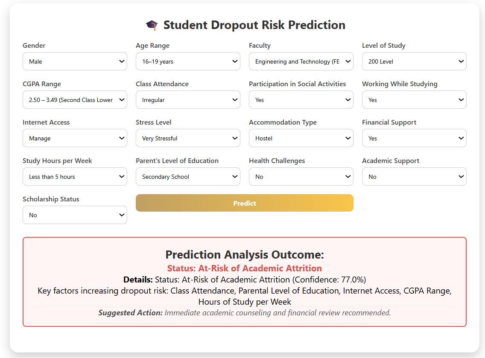
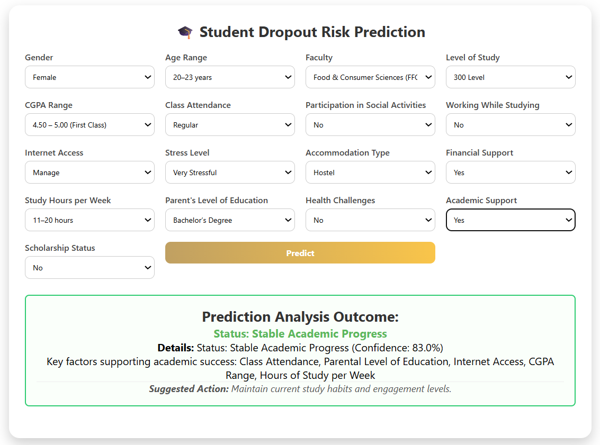

# 🎓 Intelligent Student Dropout Risk Prediction System

**An Explainable Machine Learning-Based Early Warning System for Student Dropout Risk Prediction at LAUTECH, Nigeria**

[](https://www.python.org/)

[](https://scikit-learn.org/)

[](https://shap.readthedocs.io/)

[](https://flask.palletsprojects.com/)

[]()

## 📚 Table of Contents

- [Project Overview](#project-overview)

- [Problem Statement](#problem-statement)

- [Project Objectives](#project-objectives)

- [Key Features](#key-features)

- [Dataset Description](#dataset-description)

- [Machine Learning Workflow](#machine-learning-workflow)

- [Exploratory Data Analysis](#exploratory-data-analysis)

- [Handling Class Imbalance](#handling-class-imbalance)

- [Baseline Model Comparison](#baseline-model-comparison)

- [Hyperparameter Tuning](#hyperparameter-tuning)

- [Optimized Model Comparison](#optimized-model-comparison)

- [Final Model and Evaluation](#final-model-and-evaluation)

- [Explainable AI with SHAP](#explainable-ai-with-shap)

- [Web Application](#web-application)

- [Application Screenshots](#application-screenshots)

- [Project Structure](#project-structure)

- [Installation and Setup](#installation-and-setup)

- [Technologies Used](#technologies-used)

- [Limitations](#limitations)

- [Future Improvements](#future-improvements)

- [Ethical Considerations](#ethical-considerations)

- [Research Publication](#research-publication)

- [Author](#author)

- [License](#license)

---

## 🚀 Project Overview

The **Intelligent Student Dropout Risk Prediction System** is an end-to-end machine learning project developed to predict students' self-reported intention to drop out at Ladoke Akintola University of Technology (LAUTECH), Nigeria.

The project uses student questionnaire data to investigate patterns associated with dropout intention and build a predictive model that can identify students who may require additional academic support.

Nine supervised machine learning classifiers were evaluated under a consistent experimental framework. The study addressed class imbalance using Synthetic Minority Over-sampling Technique (SMOTE), compared model performance using multiple evaluation metrics, and optimized three promising models through hyperparameter tuning and decision-threshold adjustment.

Random Forest was selected as the final classifier based on the study's early-warning objective and its performance after optimization.

To improve transparency and practical usefulness, the system integrates **SHapley Additive exPlanations (SHAP)** with a Flask web application. The application presents a student's predicted risk category, prediction probability, influential factors, and suggested interventions.

The project connects data analysis, machine learning, explainable AI, and web deployment in a practical educational decision-support application.

## ❗ Problem Statement

Student dropout can result from a combination of academic, financial, demographic, social, and health-related challenges. Identifying students who may be vulnerable before their difficulties become more serious can help academic advisers and institutional support teams consider appropriate interventions.

However, a model evaluated primarily on accuracy may overlook students in the minority at-risk class. Furthermore, predictions are less useful when users cannot understand the factors contributing to them or translate the results into practical support.

This project addresses these challenges by developing a comparative machine learning framework that:

- Investigates student characteristics associated with dropout intention.

- Evaluates nine classification algorithms.

- Addresses class imbalance without applying SMOTE to the held-out test set.

- Prioritizes at-risk detection through recall, Precision-Recall AUC, and threshold adjustment.

- Uses SHAP to explain global feature importance and individual predictions.

- Integrates the selected model into a Flask-based web application.

## 🎯 Project Objectives

1. Identify demographic, academic, financial, social, and health-related factors associated with student dropout intention.

2. Build and compare multiple machine learning classifiers under consistent experimental conditions.

3. Address class imbalance and optimize promising models to improve at-risk student detection.

4. Apply explainable AI techniques to understand model predictions.

5. Develop a web-based decision-support system that presents predictions, contributing factors, and suggested interventions.

## ✨ Key Features

- **Comparative machine learning:** Evaluation of nine classification algorithms.

- **Data preprocessing:** Missing-value handling, duplicate checks, and exploratory analysis.

- **Class imbalance handling:** SMOTE applied exclusively to training data.

- **Model optimization:** Randomized hyperparameter search with five-fold cross-validation.

- **Threshold adjustment:** Decision thresholds selected for the tuned candidate models.

- **Comprehensive evaluation:** Accuracy, precision, recall, F1-score, ROC-AUC, and PR-AUC.

- **Explainable AI:** SHAP global and local prediction explanations.

- **Flask deployment:** Browser-based student profile submission and prediction.

- **Actionable outputs:** Risk classification, prediction probability, contributing factors, and suggested interventions.

## 📊 Dataset Description

The study used primary data collected through an anonymous structured questionnaire administered to students across ten faculties at LAUTECH, Nigeria.

| Dataset Characteristic | Description |
|:---|:---|
| Initial submissions | 648 |
| Records retained after cleaning | 646 |
| Predictor features | 17 |
| Learning task | Binary classification |
| Target variable | Dropout Intention |
| Training/testing split | 80% / 20% (stratified) |
| Training records before SMOTE | 516 |
| Training records after SMOTE | 946 |
| Test set | 130 records (unchanged by SMOTE) |

### 🧩 Feature Categories

The questionnaire covered multiple dimensions of student life.

| Category | Example Variables |
|:---|:---|
| Demographic | Gender, age range |
| Academic | Faculty, level of study, CGPA range, class attendance, weekly study hours |
| Financial and socioeconomic | Parental education, source of financial support, scholarship status |
| Living and connectivity | Accommodation type, internet access |
| Social and institutional | Participation in activities, academic support |
| Health and wellbeing | Health challenges, school-related stress |
| Employment | Working while studying |

The target was formulated as a binary classification problem:

- `0` — Not at risk

- `1` — At risk

**Privacy:** The questionnaire was designed not to collect direct personal identifiers such as students' names, email addresses, or matriculation numbers in the responses used for analysis. The project focuses on patterns in student characteristics rather than identifying individual students.

The dataset was cleaned before modeling. The paper reports mode imputation for missing values, which accounted for less than 5% of the data.

> **Data availability:** The raw student survey data are not included in this repository. The reported results are based on the study dataset.

## 🔄 Machine Learning Workflow

The project follows a workflow informed by the Cross-Industry Standard Process for Data Mining (CRISP-DM).

1. **Problem definition:** Define student dropout intention prediction as a binary classification task.

2. **Data collection:** Gather questionnaire responses from students at LAUTECH.

3. **Data cleaning:** Inspect missing values, duplicate entries, outliers, and irrelevant columns.

4. **Exploratory Data Analysis:** Examine distributions, descriptive statistics, relationships, and potential risk patterns.

5. **Preprocessing:** Apply the documented missing-value treatment and prepare features for modeling.

6. **Data splitting:** Use stratified training and testing partitions.

7. **Class imbalance handling:** Apply SMOTE exclusively to the training data.

8. **Baseline model training:** Evaluate nine candidate classifiers.

9. **Hyperparameter optimization:** Tune Random Forest, CatBoost, and XGBoost.

10. **Threshold adjustment:** Evaluate decision thresholds for the tuned models.

11. **Model evaluation:** Compare classification metrics, ROC-AUC, PR-AUC, and confusion matrices.

12. **Explainability:** Apply SHAP to interpret global model behavior and an individual prediction.

13. **Deployment:** Integrate the selected model into a Flask web application.

## 🔍 Exploratory Data Analysis

Exploratory Data Analysis (EDA) was conducted to investigate the dataset and understand potential patterns related to dropout intention.

The analysis considered:

- Descriptive statistics and frequency distributions.

- Class distribution and the extent of class imbalance.

- Academic characteristics, including CGPA, attendance, and study hours.

- Financial support, parental educational background, and internet access.

- Health challenges, academic support, and school-related stress.

- Visualizations and relationships among selected features.

These analyses provided context for the modeling stage and helped characterize the data used to develop the early-warning system.

## ⚖️ Handling Class Imbalance

The cleaned dataset exhibited a substantial imbalance between the two target classes.

| Training Stage | Not at Risk | At Risk | Total |
|:---|---:|---:|---:|
| Before SMOTE | 473 | 43 | 516 |
| After SMOTE | 473 | 473 | 946 |

The at-risk class represented approximately 8.33% of the original training partition.

To address this imbalance, the study applied **Synthetic Minority Over-sampling Technique (SMOTE)** to generate synthetic minority-class examples.

The resampled training set contained 946 observations, with 473 observations in each class.

SMOTE was restricted to the training partition. The held-out test set remained unchanged so that final evaluation reflected the original class distribution rather than an artificially balanced test set.

This distinction is important because oversampling the test data would compromise the validity of the final evaluation.

## 📈 Baseline Model Comparison

Nine supervised machine learning classifiers were evaluated using the same training and held-out test partitions.

The models covered linear, tree-based, ensemble, boosting-based, and kernel-based learning approaches.

### 📋 Baseline Performance Results

The following table reproduces the baseline comparison reported in the paper. Values are shown as reported, with scores expressed as decimals.

| Model | CV F1 | Train Accuracy | Test Accuracy | Precision | Recall | F1-Score | ROC-AUC | PR-AUC |
|:---|---:|---:|---:|---:|---:|---:|---:|---:|
| XGBoost | 0.9322 | 0.9989 | 0.9077 | 0.4667 | 0.6364 | 0.5385 | 0.7647 | 0.3501 |
| CatBoost | 0.9411 | 0.9947 | 0.9000 | 0.4286 | 0.5455 | 0.4800 | 0.7968 | 0.4924 |
| Random Forest | 0.9457 | 0.9989 | 0.8846 | 0.3333 | 0.3636 | 0.3478 | 0.7781 | 0.4839 |
| AdaBoost | 0.8847 | 0.9186 | 0.8385 | 0.2727 | 0.5455 | 0.3636 | 0.7387 | 0.2364 |
| Gradient Boosting | 0.9246 | 0.9588 | 0.8692 | 0.2857 | 0.3636 | 0.3200 | 0.7876 | 0.3118 |
| Decision Tree | 0.9085 | 0.9989 | 0.8308 | 0.2105 | 0.3636 | 0.2667 | 0.6188 | 0.1304 |
| Support Vector Machine | 0.9267 | 0.9641 | 0.9000 | 0.3750 | 0.2727 | 0.3158 | 0.7517 | 0.2552 |
| Logistic Regression | 0.8805 | 0.8964 | 0.8077 | 0.1500 | 0.2727 | 0.1935 | 0.6914 | 0.2379 |
| Ridge Classifier | 0.8837 | 0.8975 | 0.8154 | 0.1176 | 0.1818 | 0.1429 | 0.7158 | 0.2510 |

*Source: Baseline model comparison reported in the research paper.*

### 💡 Baseline Findings

The baseline results show that performance differed across the evaluation metrics.

- Random Forest recorded the highest reported cross-validated F1-score of **0.9457**.

- XGBoost achieved the highest baseline test recall of **0.6364**.

- CatBoost recorded the highest baseline ROC-AUC of **0.7968** and PR-AUC of **0.4924**.

These differences motivated further optimization of Random Forest, CatBoost, and XGBoost rather than relying on a single baseline metric.

## 🛠️ Hyperparameter Tuning

The three selected candidate models were optimized using `RandomizedSearchCV`.

The search procedure sampled 30 parameter combinations per model and used five-fold cross-validation, resulting in 150 candidate evaluations per classifier and 450 evaluations across the three models.

Recall maximization was used as the stated cross-validation selection objective.

### 🌲 Random Forest

| Hyperparameter | Selected Value |
|:---|:---|
| `n_estimators` | 100 |
| `max_depth` | 30 |
| `min_samples_split` | 2 |
| `min_samples_leaf` | 1 |
| `max_features` | `log2` |
### 🐈 CatBoost

| Hyperparameter | Selected Value |
|:---|:---|
| `iterations` | 500 |
| `learning_rate` | 0.05 |
| `depth` | 10 |
| `l2_leaf_reg` | 9 |
| `border_count` | 64 |

### 🚀 XGBoost

| Hyperparameter | Selected Value |
|:---|:---|
| `n_estimators` | 500 |
| `learning_rate` | 0.2 |
| `max_depth` | 3 |
| `min_child_weight` | 1 |
| `subsample` | 1.0 |
| `colsample_bytree` | 1.0 |
| `gamma` | 0 |

These configurations are the optimal settings reported by the study.

## 🏆 Optimized Model Comparison

After hyperparameter tuning and threshold adjustment, the three candidate models were evaluated on the held-out test set.

### 📊 Performance of the Three Tuned Models

| Model | CV F1 | Threshold | Test Accuracy | Precision | Recall | F1-Score | ROC-AUC | PR-AUC |
|:---|---:|---:|---:|---:|---:|---:|---:|---:|
| Random Forest | 0.9427 | 0.40 | 0.8846 | 0.3889 | 0.6364 | 0.4828 | 0.7895 | 0.5152 |
| CatBoost | 0.9413 | 0.60 | 0.9231 | 0.5556 | 0.4545 | 0.5000 | 0.7869 | 0.4909 |
| XGBoost | 0.9324 | 0.25 | 0.8769 | 0.3529 | 0.5455 | 0.4286 | 0.7410 | 0.3599 |

*Source: Optimized model performance reported in the research paper.*

### ✅ Why Random Forest Was Selected

Random Forest was selected because the study prioritized identifying students in the minority at-risk class.

Compared with the other tuned models, Random Forest achieved:

- The highest recall: **63.64%**.

- The highest ROC-AUC: **78.95%**, narrowly above CatBoost.

- The highest PR-AUC: **51.52%**.

CatBoost achieved higher test accuracy, precision, and F1-score. However, Random Forest detected a larger proportion of the actual at-risk cases, which aligned with the intended early-warning use case.

The selection therefore reflects the study's chosen evaluation priorities, rather than a claim that Random Forest was superior on every metric.

## 🧪 Final Model and Evaluation

The selected Random Forest classifier used a decision threshold of **0.40** for classification.

### 📉 Final Test Performance

| Metric | Result |
|:---|---:|
| Accuracy | 88.46% |
| Precision | 38.89% |
| Recall | 63.64% |
| F1-Score | 48.28% |
| ROC-AUC | 78.95% |
| PR-AUC | 51.52% |
| Classification Threshold | 0.40 |

### 🔢 Confusion Matrix

The final test evaluation reported the following classification outcomes:

| Actual / Predicted | Not at Risk | At Risk |
|:---|---:|---:|
| Not at Risk | 108 | 11 |
| At Risk | 4 | 7 |

The model correctly identified **7 of the 11 actual at-risk cases** in the test set, while missing 4 at-risk cases.

It also generated 11 false-positive predictions. These results illustrate the trade-off between identifying more potentially vulnerable students and incorrectly flagging students who may not be at risk.

The test set contained only 11 at-risk observations. Consequently, the reported recall and other minority-class metrics should be interpreted cautiously and validated using larger, preferably longitudinal datasets.

## 🧠 Explainable AI with SHAP

A key component of the project is **Explainable Artificial Intelligence (XAI)**. Rather than returning only a risk classification, the system incorporates SHAP to help users understand the factors contributing to model predictions.

SHAP assigns feature contribution values that indicate how individual features influence the model output relative to a baseline.

### 🌍 Global Explainability

Global SHAP analysis was used to examine the overall influence of input features on the Random Forest predictions.

The project reports class attendance as the most influential feature in the displayed SHAP beeswarm plot. The conclusion also identifies the following important predictors:

- Class attendance.

- Internet access.

- Parental level of education.

- Hours of study per week.

- CGPA range.

The beeswarm plot illustrates how feature values relate to SHAP contributions across observations. Positive SHAP values push the model output toward the at-risk class, while negative values push it away from that class.

These findings represent patterns learned by the model and should not be interpreted as proof that a particular factor causes student dropout.

### 🔎 Local Explainability

Local SHAP analysis was used to explain the prediction for an individual student.

The project reports an example with a base value of **0.5033** and a final model output of **0.07**. In that example:

- Absence of academic support was the main factor pushing the risk score upward.

- Good class attendance contributed toward a lower score.

- A high CGPA range contributed toward a lower score.

- Higher parental education contributed toward a lower score.

- The reported study-hours value contributed toward a lower score.

- The student's Faculty of Computing and Informatics membership also contributed toward a lower score.

Together, the reported contributions produced a low-risk prediction for that example.

The SHAP force plot provides an instance-level explanation of the model's output, making it easier to inspect how several features combine to influence a prediction.

**Interpretation note:** The paper's example output of 0.07 should not automatically be assumed to be a calibrated probability or the same output scale used by the Flask interface. The implementation should clearly identify the quantity being displayed.

## 💻 Web Application

The selected model was integrated into a Flask-based web application built with Python, HTML, and CSS.

The application accepts a student profile as input and produces a prediction intended to support early identification and academic advising.

### ⚙️ Application Capabilities

- Collects student profile information through a web form.

- Processes submitted inputs for model prediction.

- Classifies the student as either **At-risk of Academic Attrition** or **Stable Academic Progress**.

- Displays the model's prediction output.

- Presents influential factors to support interpretation.

- Provides suggested intervention measures to guide follow-up support.

The system is designed as a decision-support tool. Its predictions should complement professional judgment and appropriate student support processes, rather than independently determine access to educational opportunities.

## 🖼️ Application Screenshots

### 🚨 At-Risk Prediction



### 📘 Stable Academic Progress



## 🗂️ Project Structure

The following is the presentation of the project structure.

Final-Year-ML-Project/
│
├── notebook/
│   ├── data/
│   │   ├── preprocessed_data.csv
│   │   └── README.md
│   │
│   ├── EDA_FE.ipynb
│   └── Model_Building.ipynb
│
├── src/
│   ├── components/
│   │   ├── __init__.py
│   │   ├── data_ingestion.py
│   │   ├── data_transformation.py
│   │   └── model_trainer.py
│   │
│   ├── pipeline/
│   │   ├── __init__.py
│   │   ├── prediction_pipeline.py
│   │   └── training_pipeline.py
│   │
│   ├── exception.py
│   ├── logger.py
│   └── utils.py
│
├── static/
│   └── style.css
│
├── templates/
│   ├── home.html
│   └── index.html
│
├── models/
│   ├── model.pkl
│   └── preprocessor.pkl
│
├── .gitignore
├── application.py
├── LICENSE
├── README.md
├── requirements.txt
└── setup.py

## 📦 Installation and Setup

### 📝 Prerequisites

- Python 3.12, as reported for the research environment.

- Git.

- A compatible Python package environment.

- A web browser.

### 📥 1. Clone the Repository

```bash

git clone https://github.com/OLATECh001/Intelligent-ML-System-for-Student-dropout.git

cd Final Year ML Project

```

### 🧪 2. Create a Virtual Environment

On Windows:

```bash

python -m venv .venv

.venv\Scripts\activate

```

### 📚 3. Install Dependencies

```bash

python -m pip install --upgrade pip

pip install -r requirements.txt

```

### ▶️ 4. Start the Flask Application

```bash

python application.py

```

## 🧰 Technologies Used

| Technology | Purpose |
|:---|:---|
| Python | Core programming language |
| Pandas | Data manipulation and analysis |
| NumPy | Numerical computation |
| Matplotlib | Data visualization |
| Scikit-learn | Model training, evaluation, and hyperparameter search |
| imbalanced-learn | SMOTE class balancing |
| XGBoost | Gradient-boosted tree classifier |
| CatBoost | Gradient-boosted classifier |
| SHAP | Global and local explainability |
| Flask | Web application and prediction interface |
| HTML and CSS | Front-end structure and styling |
| Jupyter Notebook | Data exploration and experimentation |
| Visual Studio Code | Development environment |
| Git and GitHub | Version control and project hosting |
## ⚠️ Limitations

The project has several limitations that should be considered when interpreting its findings.

1. **Self-reported target:** The target variable is student dropout intention, which may not correspond to actual dropout behavior.

2. **Single-institution study:** The data were collected at LAUTECH, so findings may not generalize to other universities.

3. **Limited minority-class test sample:** Only 11 at-risk cases were reported in the held-out test set, making minority-class estimates uncertain.

4. **False positives and false negatives:** The selected model produced both incorrect at-risk flags and missed at-risk cases.

5. **Generalization:** Further evaluation is needed before using the model for operational decisions involving real students.

6. **Interpretability limitations:** SHAP explains model behavior; it does not establish causation or guarantee that a prediction is correct.

## 🔮 Future Improvements

Potential improvements include:

- Validate the model on larger datasets and data from additional Nigerian universities.

- Use longitudinal academic records to compare predicted risk with actual student outcomes, where appropriately authorised.

- Evaluate probability calibration and prediction stability.

- Examine performance across relevant student groups to identify potential biases.

- Improve intervention recommendations through collaboration with academic advisers and student-support professionals.

- Add monitoring for data drift, prediction quality, and model performance.

- Improve deployment reproducibility through documented environments and automated testing.

- Evaluate whether interventions informed by model outputs improve student outcomes.

## 🛡️ Ethical Considerations

This project is intended to support student welfare and academic retention.

The research paper describes an anonymous questionnaire and reports that informed consent and confidentiality guidance were presented to participants at the beginning of the survey.

The system should be used with appropriate safeguards:

- Keep student data private and access-controlled.

- Avoid exposing raw survey responses or sensitive information in a public repository.

- Do not treat a prediction as proof that a student will drop out.

- Use risk predictions to offer support rather than punish, stigmatize, or exclude students.

- Provide human review before consequential decisions.

- Validate the model's reliability and fairness before real-world institutional deployment.

## 📄 Research Publication

This project is based on a research study titled:

**Machine Learning-Based Student Dropout Risk Prediction at LAUTECH, Nigeria: An Explainable Early Warning System**

The study examines comparative classification, class imbalance handling, hyperparameter optimization, threshold adjustment, SHAP explainability, and Flask deployment.

The manuscript is under writting, the Link and DOI will soon available once the paper get published.

## 👨‍💻 Author

**Rasheed Sikiru Olamide**

Computer Science | Data Science and Machine Learning

GitHub: [@OLATECh001](https://github.com/OLATECh001)

LinkedIn: [Olamide Rasheed](https://www.linkedin.com/in/olamide-rasheed-4535a6384/)

## 📜 License

This project is licensed under the MIT License. See the [LICENSE](LICENSE) file for details.

---

*This repository documents an academic machine learning project developed to investigate student dropout intention and demonstrate an explainable, web-based early warning approach. The reported results are experimental and should not be interpreted as proof of real-world dropout outcomes or causal relationships.*